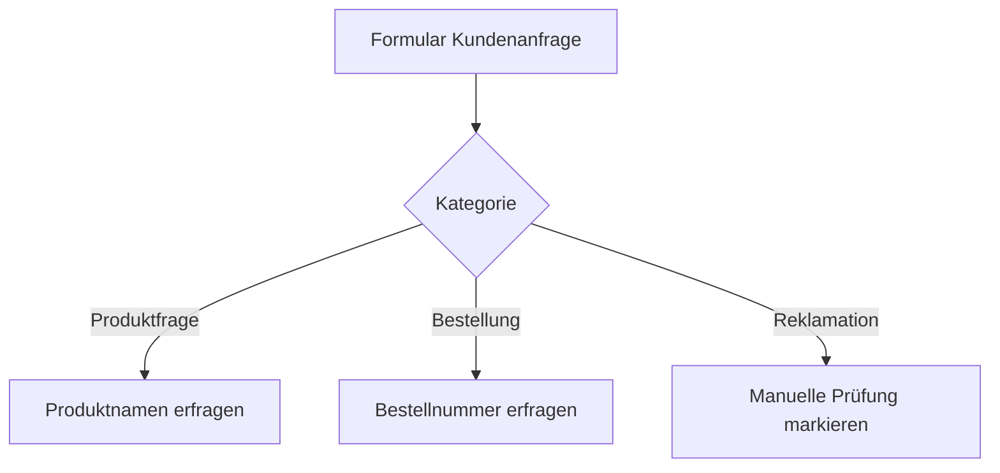

# Kundenanfragen – Fiktive Kosmetikmarke

Übungsprojekt zur Lerneinheit 04 der Weiterbildung KI-Integrationsmanagerin (IHK).

## Projektziel

Der Workflow erfasst Kundenanfragen über ein Formular und bereitet anhand der gewählten Kategorie einen Antwortentwurf vor. Reklamationen erhalten den Status „Manuelle Prüfung erforderlich“, damit der Kundenservice sie einzeln beurteilen kann.

## Werkzeuge

- **n8n Cloud** für Formular, Routing und Antwortentwürfe.
- **GitHub** zur Dokumentation und Bereitstellung des Workflow-Exports.

Der Prototyp nutzt feste Regeln und Textvorlagen. Die Ergebnisse bleiben zur Prüfung in n8n. Für die Ausführung sind keine externen Dienste oder API-Schlüssel erforderlich.

## Ablauf

1. **On form submission** empfängt die Pflichtfelder `Kategorie` und `Nachricht`.
2. **Switch** ordnet die Anfrage anhand der gewählten Kategorie einem von drei Ausgängen zu.
3. Der jeweilige **Edit Fields**-Knoten übernimmt die Eingabefelder und ergänzt `Status` und `Antwortentwurf`.

## Testergebnisse

| Kategorie | Testnachricht | Status | Nachweis |
|---|---|---|---|
| Produktfrage | Ist die Gesichtscreme parfümfrei? | Entwurf erstellt | [Screenshot](screenshots/Produktfrage.png) |
| Bestellung | Wo ist meine Bestellung TEST-123? | Entwurf erstellt | [Screenshot](screenshots/Bestellung.png) |
| Reklamation | Der Pumpspender ist beschädigt. | Manuelle Prüfung erforderlich | [Screenshot](screenshots/Reklamation.png) |

## Herausforderung und Lernerfahrung

Beim ersten Bestelltest meldete n8n eine erfolgreiche Ausführung, obwohl der Bestellknoten keine Daten erhielt. Die Formularoption enthielt ein Leerzeichen am Ende. Der Switch verglich den Wert mit `Bestellung`. Die Regel für diesen Pfad entfernt nun mit `trim()` führende und nachgestellte Leerzeichen vor dem Vergleich. Beim erneuten Test erhielt der Bestellknoten ein Element und erzeugte den erwarteten Entwurf.

Beim Testen eines verzweigten Workflows prüfe ich deshalb zusätzlich zum Gesamtergebnis den konkreten Switch-Ausgang und die Daten im Zielknoten.

## Workflow testen

1. [workflow.json](workflow.json) in n8n importieren.
2. Den Workflow im Editor ausführen und das Testformular absenden.
3. Die Ausgabe des zur Kategorie gehörenden Knotens auf `Status` und `Antwortentwurf` prüfen. Für jede Kategorie einen eigenen Testlauf starten.
