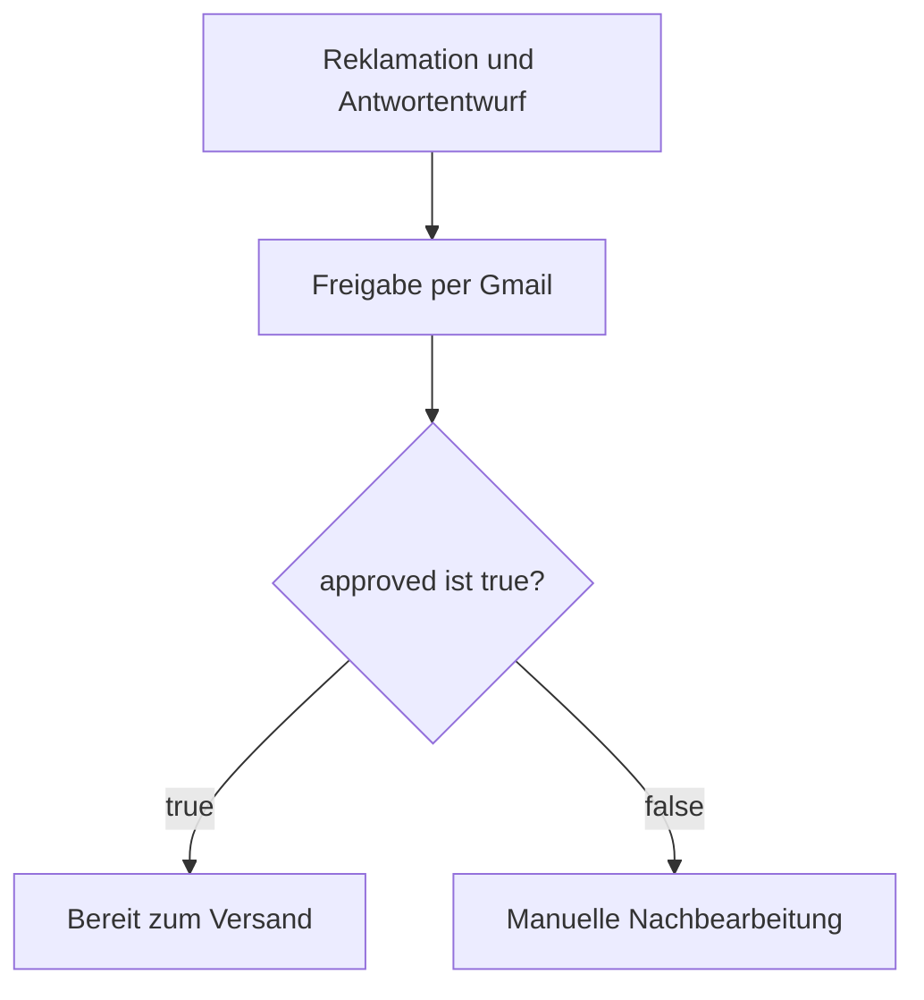

# Kundenanfragen – Fiktive Kosmetikmarke

**Lerneinheit 07 – Erweiterung bestehender Projekte**  
**Verfasserin:** Inès-Laure Nyamat  
**Dokumentationsstand:** 19.11.2026

## 1. Kurzbeschreibung
Der n8n-Workflow erfasst Kundenanfragen über ein Formular und leitet sie anhand der ausgewählten Kategorie an Produktfrage, Bestellung oder Reklamation weiter. Die Erweiterung ergänzt den Reklamationszweig um eine menschliche Freigabe per E-Mail und eine anschließende Statusentscheidung.

Die Kategorien werden durch die Auswahl im Formular und feste Switch-Regeln bestimmt. Die Antwortentwürfe der drei Kategorien sind hinterlegte Texte. Im Produktfragezweig ist zusätzlich eine semantische Suche in einer kleinen Produkt-FAQ eingerichtet.

## 2. Ziel und Nutzen
Die Erweiterung macht die Freigabe einer Reklamationsantwort zu einem ausdrücklichen Prozessschritt. Der Kundenservice erhält den Entwurf per E-Mail und entscheidet über die weitere Bearbeitung. Dadurch werden Freigaben und Ablehnungen technisch unterscheidbar und die Zuständigkeit für die fachliche Entscheidung sichtbar.

Erwarteter Nutzen sind eine einheitliche Bearbeitung, weniger versehentlich freigegebene Antworten und eine nachvollziehbare Entscheidung. Zeitersparnis und Fehlerreduktion wurden bisher nicht quantitativ gemessen.

## 3. Beschreibung der Erweiterung
An den bestehenden Knoten „Reklamation “ wurden folgende Knoten angeschlossen:

- Gmail „Send message and wait for response“ sendet den Entwurf an die konfigurierte prüfende Person und wartet auf Approve oder Decline.
- „If“ prüft den booleschen Wert `{{ $json.data.approved }}` mit „is true“.
- „Bereit zum Versand“ setzt bei Freigabe den Status.
- „Manuelle Nachbearbeitung “ setzt bei Ablehnung den Status für eine weitere menschliche Bearbeitung.

Die Erweiterung wurde gewählt, weil Reklamationen eine fachliche Prüfung benötigen und die Entscheidung im Kundenservice bleiben soll.

## 4. Ablauf des Workflows
1. „On form submission“ erfasst die Pflichtfelder `Kategorie` und `Nachricht`.
2. „Switch“ wertet die Kategorie aus. Für Bestellung entfernt `.trim()` das Leerzeichen aus dem Formularwert.
3. „Reklamation “ ergänzt `Status = Manuelle Prüfung erforderlich` und den vordefinierten `Antwortentwurf`. Die ursprünglichen Eingabefelder bleiben an dieser Stelle erhalten.
4. Gmail sendet `{{ $json.Antwortentwurf }}` mit dem Betreff „Freigabe erforderlich – Reklamation“ an die konfigurierte Prüfadresse.
5. Die prüfende Person liest den Text und klickt auf Approve oder Decline. Gmail gibt `data.approved` und `data.respondedAt` zurück.
6. „If“ leitet `true` an „Bereit zum Versand“ und `false` an „Manuelle Nachbearbeitung “ weiter.
7. Der jeweilige Endknoten gibt den Status aus.

Die Endknoten geben jeweils ausschließlich `Status` aus. Die ursprüngliche Nachricht und der Entscheidungszeitpunkt können in den vorherigen Knoten der Ausführung eingesehen werden. Der Versand einer endgültigen Kundenantwort und die Zuweisung eines Tickets sind mögliche weitere Ausbauschritte.

## 5. Tools und KI-Modelle
| Bestandteil | Verwendung und Auswahlgrund |
| --- | --- |
| n8n Form Trigger | Strukturierte Erfassung über ein Formular |
| Switch | Verständliche Weiterleitung anhand fester Regeln |
| Edit Fields (Set) | Hinterlegte Antworttexte und definierte Statuswerte |
| Gmail | E-Mail-basierte Freigabe mit Wartefunktion |
| If | Auswertung der booleschen Freigabeentscheidung |
| Simple Vector Store | Semantische Suche in einer überschaubaren Produkt-FAQ |
| Embeddings OpenAI | Vektorisierung der FAQ und der Produktfrage |
| Default Data Loader | Bereitstellung der im Workflow hinterlegten FAQ |

Das konkrete OpenAI-Embedding-Modell ist im Export nicht explizit eingestellt und muss beim Import in der verwendeten n8n-Version geprüft werden. Der Reklamationszweig arbeitet mit einem festen Antworttext. Die semantische Suche ist dem Produktfragezweig zugeordnet.

## 6. Daten
Verarbeitet werden Kategorie, Nachricht, Eingangszeitpunkt, Formularmodus, Antwortentwurf, Status, Freigabeentscheidung und Antwortzeitpunkt. Hinzu kommen die konfigurierte Prüfadresse und die technischen Kontoverbindungen.

Die Beispiel-FAQ umfasst Anwendung, Füllmenge und Aufbewahrung eines fiktiven Vitamin-C-Serums. Für Tests werden erfundene Reklamationen verwendet, etwa „Die Flasche wurde beschädigt geliefert“. Freitext kann im späteren Betrieb personenbezogene oder vertrauliche Informationen enthalten. Die Prüfadresse gehört zur Testkonfiguration und wird vor einer Weitergabe an andere Betreiber angepasst.

## 7. Integration im Unternehmen
Voraussetzungen sind eine betriebene n8n-Instanz, ein autorisiertes Gmail-Konto, eine erreichbare Rückrufadresse für die Freigabe und eine benannte Person im Kundenservice. Für den Produktfragezweig wird zusätzlich eine OpenAI-API-Verbindung benötigt.

Der Kundenservice verantwortet Inhalt, Freigabe und Nachbearbeitung. Die IT verantwortet Betrieb, Zugänge, Sicherungen, Updates und Störungsbehebung. Eine fachlich verantwortliche Person genehmigt Änderungen an Antworttexten und FAQ. Datenschutz und Informationssicherheit bewerten die vorgesehene Verarbeitung vor einer betrieblichen Einführung.

Vor dem Dauerbetrieb sind Vertretung, Reaktionsfristen und Eskalation für unbeantwortete Freigaben festzulegen. Die gezeigte Konfiguration enthält keinen eingerichteten Eskalationspfad für ausbleibende Antworten. Die Statusausgabe ist für die Übergabe an ein Ticket- oder CRM-System zu ergänzen, wenn dort weitergearbeitet werden soll.

## 8. Governance und Compliance
Vor dem Einsatz sind folgende Prüfungen und betriebliche Festlegungen vorgesehen:

- Datenschutz einschließlich Zweck, Rechtsgrundlage, Datenminimierung, Aufbewahrung und Löschung, Betroffenenrechten sowie erforderlichen Vereinbarungen mit Dienstleistern.
- Informationssicherheit einschließlich Berechtigungen, sicherer Zugangsdatenverwaltung und Schutz der Freigabelinks.
- Bewertung der KI-Komponente im vorgesehenen Anwendungsfall unter Berücksichtigung des EU AI Act und der Schulung der zuständigen Beschäftigten.
- Nutzungsrechte an FAQ und sonstigen eingebundenen Inhalten.
- Beteiligung zuständiger betrieblicher Stellen und gegebenenfalls der Beschäftigtenvertretung.
- Einhaltung interner Vorgaben zur Kundenkommunikation und Freigabe von Antworten.

Diese Punkte bilden einen Prüfplan für die Einführung. Die technische Demonstration belegt die Funktion der getesteten Freigabezweige.

## 9. Risiken und Gegenmaßnahmen
| Risiko | Gegenmaßnahme bzw. vorgesehene Ergänzung |
| --- | --- |
| Unpassender Standardtext | Fachliche Prüfung und regelmäßige Überarbeitung |
| Freigabe durch falsche Person oder weitergeleiteten Link | Zugriff auf Prüfpostfach und Links begrenzen, Verantwortlichkeiten festlegen |
| Unbeantwortete Freigabe | Offene Ausführungen überwachen, Fristen und Eskalation ergänzen |
| Gmail- oder Verbindungsfehler | Ausführung prüfen und vor erneutem Versand kontrollieren, ob bereits eine Nachricht versendet wurde |
| Doppelte Formularübermittlung | Vor Produktivbetrieb Vorgangskennung und Dublettenprüfung ergänzen |
| Personenbezogene Daten im Freitext | Datenminimierung, eingeschränkte Zugriffe und Löschkonzept |
| Unvollständige oder unpassende FAQ-Treffer | FAQ pflegen, Treffer fachlich prüfen und begrenzten Wissensumfang kenntlich machen |
| Flüchtiger Vector Store | Für Tests FAQ erneut laden, dauerhafte Wissensablage vor dem Produktivbetrieb prüfen |
| Verlust des Vorgangsbezugs bei Übergabe | Bei Anbindung eines Folgesystems Nachricht, Kennung und Entscheidung gemeinsam übergeben |

## 10. Menschliche Kontrolle
Die prüfende Person entscheidet über jeden im Reklamationszweig versendeten Entwurf. Approve führt zum Status „Bereit zum Versand“. Decline führt zu „Manuelle Nachbearbeitung“. Eine individuelle Lösung der Reklamation, etwa ein Ersatz oder eine Erstattung, wird durch den Kundenservice geprüft.

Der aktuelle Standardtext bestätigt den Eingang und kündigt eine Prüfung an. Die abschließende fachliche Bearbeitung der Reklamation bleibt ein eigener Arbeitsschritt.

## 11. Test und Erfolgsmessung
Am 19.11.2026 wurden beide Entscheidungen mit fiktiven Reklamationen getestet und anhand von Ausführungsansichten sowie JSON-Ausgaben belegt.

| Test | Entscheidung | Beobachtetes Ergebnis | Bewertung |
| --- | --- | --- | --- |
| T1 | Approve | `data.approved = true`, true-Zweig, Status „Bereit zum Versand “ | Bestanden |
| T2 | Decline | `data.approved = false`, false-Zweig, Status „Manuelle Nachbearbeitung“ | Bestanden |

Die sichtbaren ausgeführten Pfade sind grün. Der Export bestätigt die entsprechenden Verbindungen. Der Freigabestatus enthält im Export ein abschließendes Leerzeichen. Bei einer späteren maschinellen Auswertung ist dieser Wert zu normalisieren oder im Knoten zu bereinigen.

Die vier Screenshots und weitere Angaben stehen in [Testnachweis.md](Testnachweis.md). Die zwei erfolgreichen Tests belegen die vorgesehenen Entscheidungspfade. Weitere Prüfungen für Betriebseinführung umfassen Ausfälle, ausbleibende Antworten, doppelte Eingaben sowie die übrigen Anfragekategorien.

Mögliche spätere Kennzahlen sind Bearbeitungsdauer, Zahl offener Freigaben, Anteil der Nachbearbeitungen und technische Fehlerrate. Hierfür liegen bisher keine belastbaren Messwerte vor.

## 12. Installation und Nutzung
1. Die Datei `workflow.json` in eine kompatible n8n-Instanz importieren. Die eingesetzten Knotenversionen sind im Export enthalten.
2. Im Gmail-Knoten eigene autorisierte Zugangsdaten auswählen und die Prüfadresse im Feld „To“ auf das gewünschte Testpostfach setzen. Exportierte Credential-Verweise müssen in der Zielinstanz neu zugeordnet werden.
3. Für den Reklamationstest „Execute workflow“ wählen und das Testformular öffnen. Kategorie „Reklamation“ und eine erfundene Nachricht eingeben.
4. Die Freigabe-E-Mail öffnen, den Entwurf prüfen und Approve wählen. Falls eine Bestätigungsseite erscheint, die Entscheidung dort bestätigen.
5. In der Ausführung den true-Zweig und die JSON-Ausgabe des Endknotens prüfen.
6. Einen zweiten Durchlauf starten und Decline wählen. Den false-Zweig und seinen Endstatus prüfen.
7. Für Produktfragen die beiden OpenAI-Embedding-Knoten mit passenden API-Zugangsdaten verbinden. Zuerst den manuellen Ladezweig mit „Simple Vector Store1“ ausführen. Anschließend eine Produktfrage über das Formular testen. Beide Vector-Store-Knoten verwenden `vector_store_key`.
8. Für einen betrieblichen Einsatz die produktive Formularadresse und die Erreichbarkeit der Freigaberückrufe einrichten und die organisatorischen Voraussetzungen aus den Abschnitten 7 bis 10 umsetzen.

Passwörter, OAuth-Tokens und API-Schlüssel werden in n8n Credentials verwaltet. Der beigefügte Export enthält Kontoverweise, jedoch keine sichtbaren geheimen Zugangswerte. Vor Veröffentlichung sind Prüfadresse und technische Metadaten zu kontrollieren.

## Enthaltene Dateien
- `workflow.json` – unveränderter übermittelter Export mit der Erweiterung
- `README.md` – Dokumentation
- `Testnachweis.md` – Testbeschreibung mit Bildbelegen
- `nachweise/` – vier Screenshots der beiden Tests
