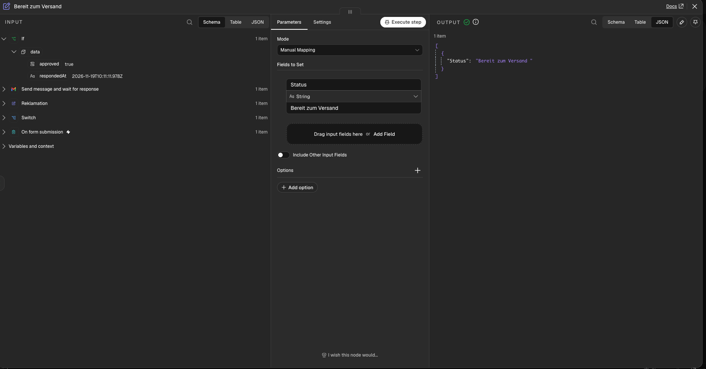
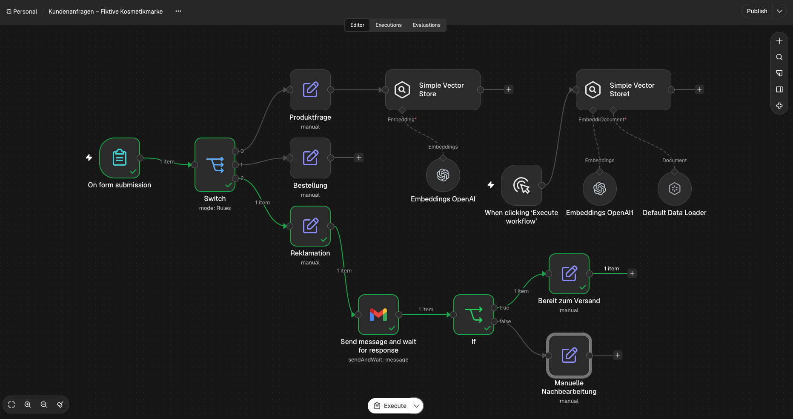
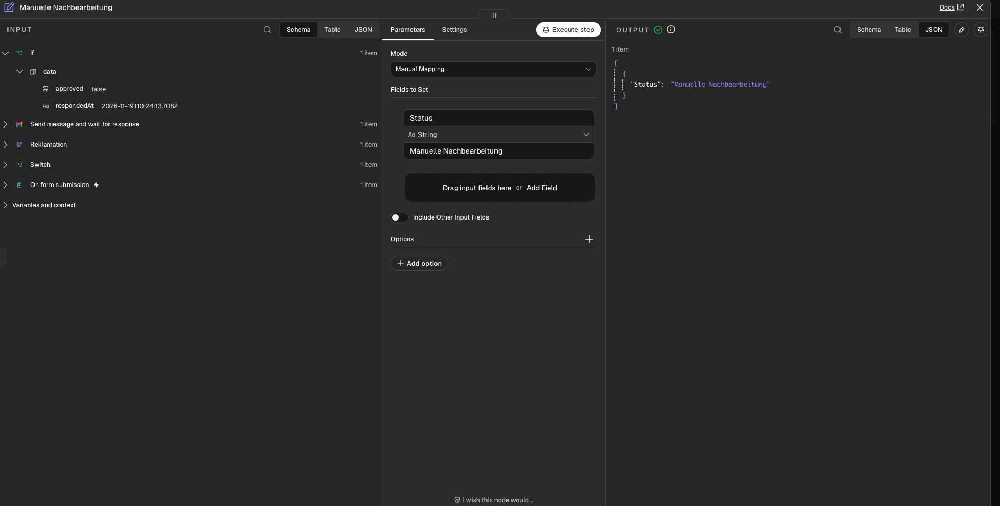
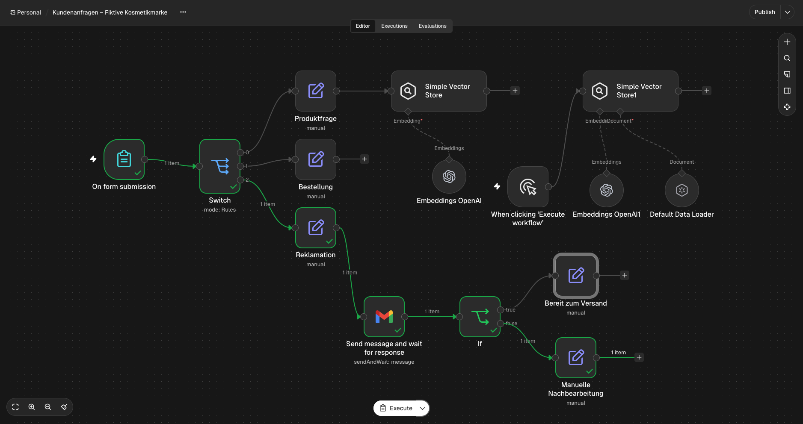

# Testnachweis – Lerneinheit 07

**Projekt:** Kundenanfragen – Fiktive Kosmetikmarke  
**Verfasserin:** Inès-Laure Nyamat  
**Testdatum:** 19.11.2026

## Testziel
Nachweis, dass eine menschliche Entscheidung per E-Mail den Reklamationszweig zuverlässig in den vorgesehenen Endstatus leitet.

## Testaufbau
Formular → Switch → Reklamation → Gmail-Freigabe → If → Statusknoten. Für beide Tests wurde eine fiktive Reklamation eingereicht. Die prüfende Person beantwortete jeweils die Freigabe-E-Mail.

## T1 – Freigabe
**Aktion:** Approve in der Freigabe-E-Mail auswählen.  
**Erwartung:** `data.approved = true`, true-Zweig und Status „Bereit zum Versand“.  
**Beobachtung:** Die Ausführungsansicht zeigt den grünen Pfad bis „Bereit zum Versand“. In der Detailansicht steht `approved = true`. Die JSON-Ausgabe enthält `"Status": "Bereit zum Versand "`. Der Wert besitzt ein abschließendes Leerzeichen.  
**Antwortzeitpunkt laut Ausgabe:** 19.11.2026, 11:11:11.978 Uhr MEZ (`2026-11-19T10:11:11.978Z`).  
**Bewertung:** Bestanden. Die Freigabeentscheidung führt zum vorgesehenen Status.

## T2 – Ablehnung
**Aktion:** Decline in einer neuen Freigabe-E-Mail auswählen.  
**Erwartung:** `data.approved = false`, false-Zweig und Status „Manuelle Nachbearbeitung“.  
**Beobachtung:** Die Ausführungsansicht zeigt den grünen Pfad bis „Manuelle Nachbearbeitung“. In der Detailansicht steht `approved = false`. Die JSON-Ausgabe enthält `"Status": "Manuelle Nachbearbeitung"`.  
**Antwortzeitpunkt laut Ausgabe:** 19.11.2026, 11:24:13.708 Uhr MEZ (`2026-11-19T10:24:13.708Z`).  
**Bewertung:** Bestanden. Die Ablehnung führt zum vorgesehenen Nachbearbeitungsstatus.

## Umfang des Nachweises
Beide vorgesehenen Entscheidungspfade wurden erfolgreich durchlaufen. Der Nachweis umfasst die Statusentscheidung nach menschlicher Prüfung. Die Endknoten geben den jeweiligen Status aus. Ein anschließender Versand an einen Kunden sowie Fehler-, Last- und Langzeittests sind weitere Prüfschritte für einen erweiterten Betrieb.
